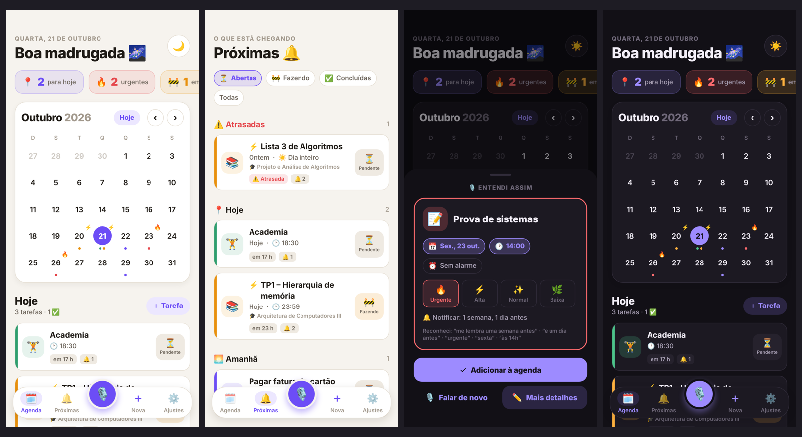
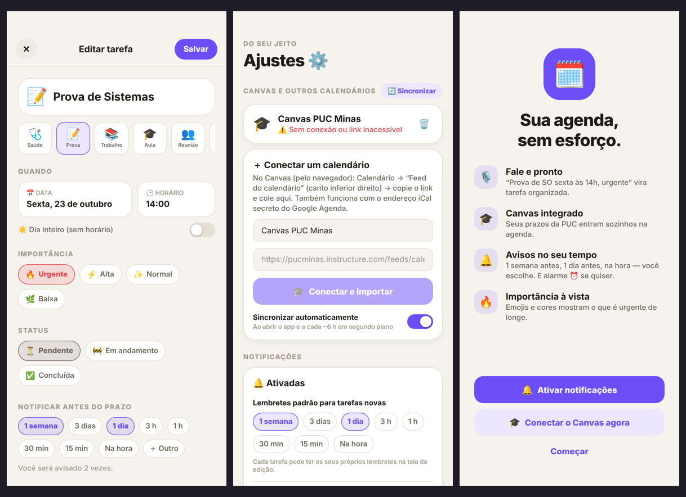
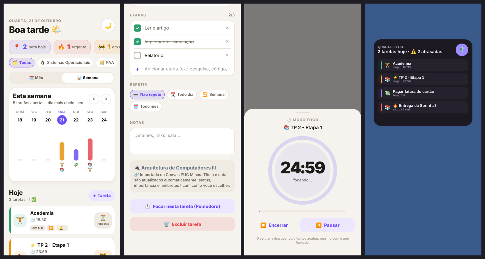

<div align="center">

# 🗓️ Agenda Inteligente

**A agenda que organiza a faculdade sozinha.**
Puxa os prazos do Canvas da PUC Minas, cria tarefas por voz e te avisa no tempo que você escolher.




</div>

---

## 📲 Instalar no celular (sem computador)

1. No celular, abra a página **[Releases](../../releases/latest)** deste repositório.
2. Toque em **`AgendaInteligente.apk`** para baixar.
3. Abra o arquivo baixado e toque em **Instalar**.
   Se o Android pedir, permita **"Instalar apps desconhecidos"** para o navegador.
4. Pronto! Abra a **Agenda Inteligente** 🎉

> O repositório é privado, então você precisa estar logado no GitHub no navegador do celular para baixar.
> Cada nova versão do código gera um APK novo automaticamente. Para atualizar, é só baixar e instalar por cima — suas tarefas continuam lá.

---

## ✨ O que o app faz

| | Recurso | Como usar |
|---|---|---|
| 🎓 | **Tarefas do Canvas** | Conecte uma vez em *Ajustes* e os prazos entram sozinhos |
| 🎙️ | **Adicionar por voz** | Toque no microfone e fale. O app reescreve e preenche tudo |
| ➕ | **Adicionar digitando** | Botão *Nova*: escreva do seu jeito, ex. "lista de BD quinta 19h" |
| 🗓️ | **Calendário** | Várias tarefas por dia, com pontinhos coloridos por importância |
| 🕑 | **Horários** | Cada tarefa tem data e hora, ou "dia inteiro" |
| 🔥 | **Importância com emojis** | 🔥 Urgente · ⚡ Alta · ✨ Normal · 🌿 Baixa |
| ⏳ | **Status** | ⏳ Pendente → 🚧 Em andamento → ✅ Concluída (toque no selo do cartão) |
| 🔔 | **Notificações** | Chegam no celular mesmo com o app fechado |
| ⏱️ | **Avisar quando quiser** | 1 semana antes, 1 dia antes, 1 hora antes, na hora… ou o tempo que você escolher |
| ⏰ | **Alarme opcional** | Toca com som de alarme, mesmo no "Não perturbe" |
| 🌙 | **Modo noturno** | Botão 🌙 no topo da tela, ou automático pelo sistema |
| ☀️ | **Resumo do dia** | Toda manhã, uma notificação com as tarefas de hoje |
| 🎨 | **Disciplinas com cor e emoji** | Cada matéria tem sua cor; filtre a agenda tocando nos chips do topo |
| 📊 | **Visão da semana** | Barras mostram quais dias estão mais cheios |
| ☑️ | **Etapas** | Divida uma tarefa em passos ("pesquisa → código → relatório") com barra de progresso |
| 🔁 | **Tarefas que se repetem** | Todo dia, toda semana (escolha os dias) ou todo mês |
| 📖 | **Blocos de estudo** | Para cada prova do Canvas, o app cria "Estudar para…" alguns dias antes |
| ⏱️ | **Modo foco (Pomodoro)** | 25 min de foco + 5 de pausa, e o app soma quanto você estudou de cada matéria |
| 📤 | **Entregas do Canvas** | Opcional: com um token, o app marca ✅ sozinho o que você já entregou |
| 🧩 | **Widget** | Suas próximas tarefas na tela inicial, com botão de microfone |
| 👆 | **Atalhos no ícone** | Segure o ícone do app: *Falar tarefa*, *Nova tarefa* ou *Próximas* |
| 💾 | **Backup** | Exporte um arquivo para o Drive/WhatsApp e restaure em outro celular |

Nas notificações aparecem os botões **✅ Concluir** e **😴 Adiar 10 min**.





---

## 🚀 Primeiros passos

### 1. Ative as notificações
Na tela de boas-vindas, toque em **Ativar notificações**. Sem isso o celular não consegue te avisar.

### 2. Conecte o Canvas
1. Abra o **Canvas pelo navegador** (no celular, use "Versão para computador" se precisar).
2. Vá em **Calendário**.
3. No canto inferior direito, toque em **Feed do calendário** e copie o link.
   Ele parece com `https://pucminas.instructure.com/feeds/calendars/user_….ics`
4. No app: **Ajustes → Conectar um calendário** → cole o link → **Conectar e importar**.

> Também funciona com o Google Agenda: em *Configurações → seu calendário → Endereço secreto em formato iCal*.

### 3. Deixe a bateria sem restrições
Para os avisos chegarem na hora certa:
**Configurações do Android → Apps → Agenda Inteligente → Bateria → Sem restrições.**
(Celulares Xiaomi, Samsung e Motorola costumam atrasar notificações sem isso.)

### 4. Teste
Em **Ajustes**, toque em **Testar lembrete** e **Testar alarme**. Eles chegam em 5 segundos.

### 5. (Opcional) Coloque o widget
Segure um espaço vazio da tela inicial → **Widgets** → **Agenda Inteligente** → arraste para a tela.

---

## 🧭 Como usar os recursos novos

<details>
<summary><b>🎨 Filtrar por disciplina e mudar cores</b></summary>

- No topo da **Agenda** e das **Próximas** aparecem chips com suas disciplinas (ex.: 🐧 Sistemas Operacionais, 🧮 PAA). Toque em um para ver só as tarefas dela; toque em **Todas** para voltar.
- Para trocar emoji ou cor: **Ajustes → Disciplinas** → toque na disciplina.
- O app tira o código da disciplina do nome: "(580100) Sistemas Operacionais" vira "Sistemas Operacionais".
</details>

<details>
<summary><b>📊 Ver a semana</b></summary>

Na **Agenda**, toque em **📊 Semana**. Cada dia ganha uma barra: quanto mais alta, mais tarefas (e mais importantes). A cor é a da tarefa mais importante do dia. Use ‹ › para trocar de semana.
</details>

<details>
<summary><b>☑️ Etapas de uma tarefa</b></summary>

Abra a tarefa → **Etapas** → escreva e toque em **OK**. Marque cada etapa conforme for fazendo: o cartão mostra a barra de progresso, a tarefa vira 🚧 *Em andamento* sozinha e ✅ *Concluída* quando todas as etapas acabam.
</details>

<details>
<summary><b>🔁 Tarefas que se repetem</b></summary>

- Ao criar ou editar: **Repetir** → *Todo dia*, *Semanal* (escolha os dias) ou *Todo mês*.
- Por voz: *"academia toda segunda e quarta às 7h"*, *"tomar remédio todo dia às 22h"*, *"pagar aluguel todo mês dia 5"*.
- Ao editar ou excluir uma tarefa que se repete, o app pergunta: **só esta** ou **esta e as próximas**.
</details>

<details>
<summary><b>📖 Blocos de estudo antes das provas</b></summary>

Quando uma prova (📝) chega pelo Canvas, o app cria **"Estudar para Prova X"** alguns dias antes, com etapas *Revisar a matéria → Fazer exercícios → Anotar dúvidas*. Se a prova mudar de data, o bloco acompanha. Se você excluir um bloco, ele não volta. Ajuste em **Ajustes → Blocos de estudo** (1 a 7 dias antes, ou desligado).
</details>

<details>
<summary><b>⏱️ Modo foco (Pomodoro)</b></summary>

Abra uma tarefa → **Focar nesta tarefa**. São 25 min de foco e 5 de pausa (a cada 4 ciclos, uma pausa maior). O celular avisa quando o tempo acaba, mesmo com o app fechado, e uma pílula na tela mostra o tempo restante. Em **Ajustes → Foco e tempo de estudo** você vê quanto estudou na semana e em cada disciplina, e pode mudar para 50 + 10 ou 15 + 3.
</details>

<details>
<summary><b>📤 Marcar sozinho o que já entreguei no Canvas (opcional)</b></summary>

O link do calendário não diz se você entregou a atividade. Com um **token de acesso**, o app consegue conferir:

1. No Canvas pelo navegador: **Conta → Configurações**.
2. Em **Integrações aprovadas**, toque em **+ Novo token de acesso**, dê um nome (ex.: *Agenda*) e gere.
3. Copie o token e cole em **Ajustes → Saber o que já entreguei**.

A cada sincronização, o que você entregou vira ✅ com o selo **📤 Entregue**. O token fica guardado com segurança só no celular e nunca vai para o backup.
> Se o Canvas não mostrar a opção de token, a PUC desativou esse recurso para alunos — o resto do app funciona normalmente.
</details>

<details>
<summary><b>👆 Atalhos e widget</b></summary>

- **Segure o ícone** do app para ver: 🎙️ *Falar tarefa*, ➕ *Nova tarefa*, 🔔 *Próximas*. Dá para arrastar um atalho para a tela inicial.
- No **widget**, o botão 🎙️ abre direto o microfone, e tocar numa tarefa abre ela no app.
</details>

<details>
<summary><b>💾 Backup e troca de celular</b></summary>

- **Ajustes → Backup → Exportar**: gera um arquivo `agenda-backup-AAAA-MM-DD.json`. Salve no Google Drive, mande no WhatsApp ou por e-mail.
- No celular novo: instale o app → **Ajustes → Backup → Restaurar** → escolha o arquivo → **Juntar** (mantém o que já existe) ou **Substituir tudo**.
- O Android também guarda os dados do app no backup da conta Google, se ele estiver ativado no celular.
</details>

<details>
<summary><b>✅ Muitas tarefas atrasadas?</b></summary>

Ao conectar um calendário pela primeira vez, o que já passou entra como concluído. Se ainda sobrar algo, vá em **Próximas → ⚠️ Atrasadas → ✅ Já fiz todas**.
</details>

---

## 🎙️ O que posso falar?

Fale naturalmente. Alguns exemplos:

- *"Prova de SO sexta às 14h, urgente, me lembra uma semana antes e um dia antes"*
- *"Entregar trabalho de PAA dia 30 às 23:59"*
- *"Dentista amanhã às 3 da tarde com alarme"*
- *"Academia às 7 e meia da manhã, alarme 30 minutos antes"*
- *"Estudar para a prova hoje à noite, sem pressa"*
- *"Academia toda segunda e quarta às 7h"*

| O app entende | Exemplos |
|---|---|
| **Datas** | hoje, amanhã, depois de amanhã, sexta, próxima segunda, dia 30, 25/11, 5 de novembro, em 3 dias, semana que vem, fim de semana |
| **Horas** | às 14h, 14:30, às 2 da tarde, 7 e meia da manhã, meio-dia, à noite |
| **Importância** | urgente, importante, sem pressa |
| **Lembretes** | "me lembra 1 semana antes e 1 dia antes", "avisa 2 horas antes", "na hora" |
| **Alarme** | "com alarme", "alarme 30 minutos antes", "me acorda às 6h" |
| **Repetição** | "todo dia", "toda segunda e quarta", "às terças", "toda semana", "todo mês" |

Antes de salvar, o app mostra **"Entendi assim"** para você conferir e ajustar. Tudo é processado no celular, sem enviar seus dados para nenhuma IA.

---

## ❓ Problemas comuns

<details>
<summary><b>Não recebo as notificações</b></summary>

- Confira se as notificações estão ativadas em *Ajustes* do app.
- Deixe a bateria do app em **Sem restrições** (passo 3 acima).
- Use **Testar lembrete** para verificar.
</details>

<details>
<summary><b>O microfone não entende o que eu falo</b></summary>

- O reconhecimento usa o app **Google** do celular. Mantenha-o atualizado.
- Para funcionar sem internet: app Google → Configurações → Voz → Reconhecimento de fala off-line → baixe **Português (Brasil)**.
- Você sempre pode digitar no campo abaixo do microfone.
</details>

<details>
<summary><b>O Canvas mostra "Link inválido ou expirado"</b></summary>

Copie o link do **Feed do calendário** de novo no Canvas e conecte outra vez. Remova o antigo com o ícone 🗑️.
</details>

<details>
<summary><b>O widget ou os atalhos não aparecem</b></summary>

Eles chegam com a versão 1.1. Instale o APK novo por cima do antigo e, se o widget não aparecer na lista, reinicie o celular.
</details>

<details>
<summary><b>Apaguei uma tarefa do Canvas e ela voltou</b></summary>

As tarefas importadas voltam na próxima sincronização. Em vez de excluir, marque como ✅ Concluída.
</details>

---

## 🔒 Privacidade

Suas tarefas ficam **só no seu celular**. O app só se conecta à internet para baixar o calendário do Canvas que você conectou.

---

## 🛠️ Para desenvolvedores

<details>
<summary><b>Como o APK é gerado</b></summary>

A cada `push` na branch `main`, o GitHub Actions ([`.github/workflows/build-apk.yml`](.github/workflows/build-apk.yml)):

1. instala as dependências compatíveis com o Expo SDK;
2. roda os testes da lógica;
3. gera o projeto Android (`expo prebuild`) e compila com Gradle;
4. publica o `AgendaInteligente.apk` em **Releases**.

Também dá para rodar manualmente em *Actions → Gerar APK → Run workflow*.
</details>

<details>
<summary><b>Rodar localmente</b></summary>

Precisa de Node.js 20.19+ e Android Studio.

```bash
npm run setup        # instala as bibliotecas nas versões certas do Expo
npm test             # testes da lógica
npm run android      # compila e abre no celular conectado por USB
```

O Expo Go não serve: o reconhecimento de voz precisa do app compilado.
</details>

<details>
<summary><b>Estrutura do projeto</b></summary>

```
App.tsx               telas, barra inferior e ações das notificações
index.ts              entrada do app + tarefa em segundo plano
src/
├── lib/              lógica pura e testada
│   ├── parser.ts     entende frases em português (voz/texto)
│   ├── ical.ts       lê o feed .ics do Canvas
│   └── logic.ts      importação, lembretes e resumo diário
│   └── backup.ts     formato do arquivo de backup
├── services/         notificações, Canvas (feed e API), voz, backup, segundo plano
├── components/       calendário, semana, cartão, editor, adição rápida, foco
├── screens/          Agenda, Próximas, Ajustes
└── widget/           widget da tela inicial
plugins/              atalhos do ícone (Android App Shortcuts)
tests/                testes (npm test)
```

**Tecnologias:** React Native + Expo, expo-notifications (lembretes e alarmes exatos), expo-speech-recognition (voz em pt-BR no aparelho), expo-background-task (sincronização a cada ~6 h), react-native-android-widget (widget), expo-secure-store (token do Canvas), expo-file-system + expo-sharing + expo-document-picker (backup), AsyncStorage.
</details>
